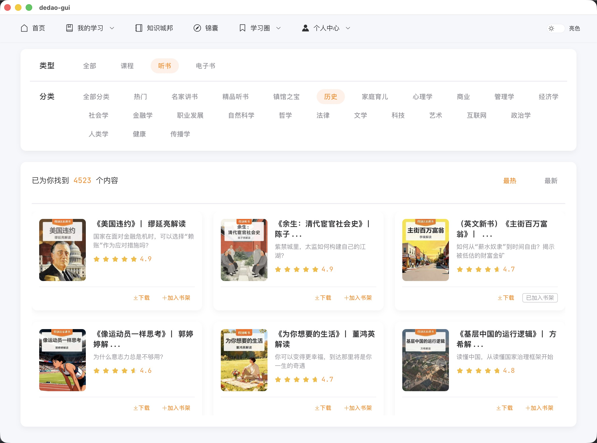
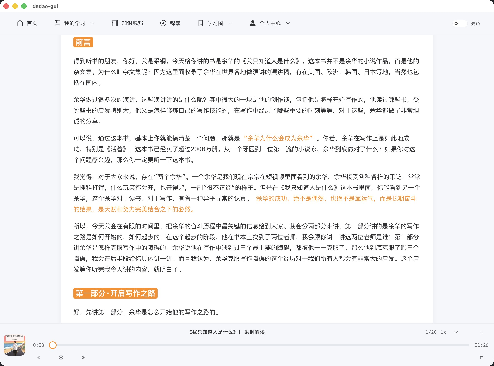
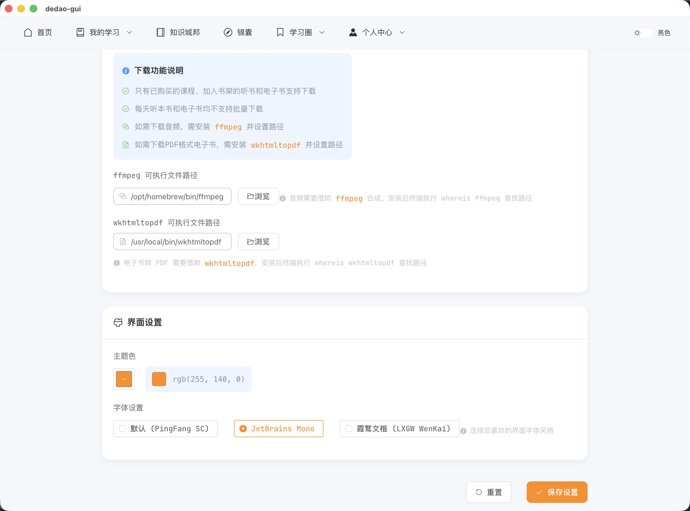

# 得到课程下载桌面端

> wails + go + vue 构建的《得到》APP 课程下载桌面客户端

## 技术栈

* [Wails v3](https://v3.wails.io/zh-Hans/) - 用于构建桌面应用程序
* [Go](https://go.dev/) - 后端服务和业务逻辑
* [Vue 3](https://cn.vuejs.org/guide/introduction.html) - 前端框架
* [Vue Router 4](https://router.vuejs.org/zh/introduction.html) - 路由管理
* [Element Plus](https://element-plus.org/zh-CN/) - UI 组件库
* [TypeScript](https://www.typescriptlang.org/zh/docs/) - 类型安全
* [Vite](https://cn.vitejs.dev/) - 构建工具
* [Pinia](https://pinia.vuejs.org/zh/) - 状态管理
* [FFmpeg](https://ffmpeg.org/) - 音频处理
* Chrome / Edge / Chromium - 默认 PDF 渲染（无界面运行）


[](https://goreportcard.com/report/github.com/yann0917/dedao-gui)
[](https://deepwiki.com/yann0917/dedao-gui)

## 特别声明

**⚡ 电子书下载已下架**：因下载接口触发账号风控，为保护账号，电子书下载功能已停用（下载时会直接返回提示），可在 dedao-dl Web 端使用在线阅读；课程、听书等其他功能不受影响。恢复时间视风控情况另行更新。

仅供个人学习使用，请尊重版权，内容版权均为得到所有，请勿传播内容！！！

仅供个人学习使用，请尊重版权，内容版权均为得到所有，请勿传播内容！！！

仅供个人学习使用，请尊重版权，内容版权均为得到所有，请勿传播内容！！！

## 主要功能

* **首页展示** - 展示首页内容概览
* **扫码登录** - 支持二维码扫描登录
* **课程管理** - 可查看**购买**的课程，课程详情，课程文章列表，支持播放课程音频
* **听书功能** - 可查看听书书架列表，听书文稿，支持播放每天听本书音频
* **电子书管理** - 可查看电子书架列表，电子书详情，书评，支持加入书架
* **锦囊查看** - 可查看已购买的锦囊
* **知识城邦** - 可查看知识城邦内容
* **内容导出** - 课程可生成PDF，文稿生成 Markdown 文档，也可生成 mp3 文件
* **听书下载** - 每天听本书可下载音频，文稿生成 pdf、 Markdown 文档
* **影音元数据** - 课程与听书 MP3 自动导出 NFO、封面和内嵌标签；支持“仅元数据”补齐已有文件，方便导入 Jellyfin 等工具
* ~~**电子书下载** - 电子书可下载 pdf，html, epub 等格式~~（已下架，见特别声明）
* **免费内容** - 免费专区的课程如：《每天听本书》，《文明》，《长谈》等，可下载音频，文稿生成 pdf、 Markdown 文档
* **学习圈** - 可查看学习圈内容（暂不支持下载）
* **主题切换** - UI亮色/暗色主题切换

### 注

1. 下载均在后台执行，下载完毕弹框会关闭，等待弹窗关闭或者点击确定下载后关闭，均会在后台执行下载程序。
2. 如果遇到 `496 NoCertificate` 消息提示，请登录网页版进行图形验证码验证。
3. 本应用上登录后再登录官方网页版会导致保存的 cookie 失效，使用 `rm -rf ~/.config/dedao/config.json` 删除配置信息后重新登陆本应用即可。或者进入个人中心，点击退出登录。

### Jellyfin / 通用音频库

课程和听书选择 **MP3** 时，自动生成 `album.nfo`、`cover.jpg`（来源提供封面时），并通过 ffmpeg 将标题、专辑、作者、曲目序号、简介及可用的发布日期写入 MP3 ID3v2 标签，封面也会内嵌。只复制音频到其他播放器时仍可显示这些信息；不会重新编码音频。

```text
下载目录/
├── 课程名/MP3/
│   ├── album.nfo
│   ├── cover.jpg
│   ├── 001.第一讲.mp3
│   └── 002.第二讲.mp3
└── 每天听本书/MP3/
    └── 书名 [内容ID]/
        ├── album.nfo
        ├── cover.jpg
        └── 书名.mp3
```

* 下载弹窗新增 **仅元数据**：不请求音频流、不下载 MP3，只生成旁车文件并给输出目录内已有的对应 MP3 补写标签。没有 MP3 时不需要 ffmpeg；已有 MP3 时仍需配置或在 PATH 中安装 ffmpeg。
* 新版听书按本书独立成目录，防止多本书共用封面。处理某本书时，如果新版目标文件不存在，会将旧版 `每天听本书/MP3/书名.mp3` 移入对应子目录；两处都有文件则保留两份，不覆盖已有音频。
* 课程目录结构不变；单篇文章的“仅元数据”只补写该篇 MP3，课程级 NFO 和封面仍共用。重复下载会跳过已有的非空 MP3；重新生成 NFO 和补写标签会覆盖相应字段，保留有效的本地 `cover.jpg`。
* 在 Jellyfin 中可按**音乐库**导入课程（每门课一个专辑），或按**有声书库**导入听书，并刷新元数据。音乐库读取 `album.nfo`；音频/有声书的标题、作者和排序依赖**内嵌标签**，不能只靠 NFO。详见 [Jellyfin NFO](https://jellyfin.org/docs/general/server/metadata/nfo/)、[音乐](https://jellyfin.org/docs/general/server/media/music/)、[有声书](https://jellyfin.org/docs/general/server/media/books/)。
* 元数据仅使用来源实际提供的字段；缺失的作者、日期或封面不会编造。封面会校验图片内容并统一为 JPEG，下载失败或标签写入失败会在下载任务中显示错误，可重试；失败时不覆盖原 MP3。
* 此功能针对课程/听书音频；PDF、Markdown 和电子书的导出行为不变。仅供个人已购内容管理，请勿传播。

## 安装与运行

### 环境要求

1. 安装 Go 1.26 或更高版本
2. 安装 Node.js 18+ 和 npm
3. 安装 Wails v3 CLI: `go install github.com/wailsapp/wails/v3/cmd/wails3@v3.0.0-beta.28`

### 构建步骤

1. 克隆项目仓库
   ```bash
   git clone https://github.com/yann0917/dedao-gui.git
   cd dedao-gui
   ```
2. 开发调试（自动构建前端与 Go 绑定，支持热更新）
   ```bash
   wails3 dev
   ```
3. 构建生产版本（Wails 会自动处理前端依赖安装和构建）
   ```bash
   wails3 build
   ```
4. 打包 macOS .app（含签名与图标资源，产物在 `bin/dedao-gui.app`）
   ```bash
   wails3 task darwin:package
   ```
5. 跨平台构建（在 macOS 上构建 Windows/Linux 版本）
   ```bash
   wails3 build GOOS=windows
   ```

> macOS 请从 `.app` 启动应用；直接运行裸二进制会因缺少 bundle 信息导致系统通知初始化失败。

详细构建说明请参考 [Wails v3 文档](https://v3.wails.io/zh-Hans/)

### 必需依赖

项目运行需要以下依赖：

* **Go** 1.26+ - 后端开发语言
* **Node.js** 18+ - 前端运行环境
* **npm** - 前端包管理器

### 可选依赖（根据需求安装）

如需使用特定功能，请安装以下依赖：

#### PDF 生成

* **Chrome / Edge / Chromium**（默认引擎）
  > 使用本机浏览器的 Headless 打印功能，适用于课程、听书文稿和电子书。无需 Node.js、ChromeDriver 或 wkhtmltopdf；建议使用 Chrome/Edge 131+（页码依赖 CSS 页边距盒）。应用会从 PATH 和常见安装目录自动查找，也可在系统设置填写“PDF 浏览器路径”，或设置 `DEDAO_CHROME_PATH`。
  > 每次导出使用独立临时浏览器配置，保留浏览器沙箱，禁止执行文档脚本；不访问日常浏览器的 Cookie、扩展或登录状态。封面、目录与正文一次渲染，保留内部链接和 PDF 大纲。

* **旧版兼容模式（不推荐新安装）**
  > 已安装 wkhtmltopdf 的用户可显式设置 `DEDAO_PDF_ENGINE=wkhtmltopdf`，继续使用设置中的旧工具路径或 `WKHTMLTOPDF_PATH`。默认不会自动回退到旧引擎；Chrome 启动失败时会返回错误。

#### 音频处理

* **ffmpeg**
  > 音频合成及处理需要借助 [ffmpeg](https://ffmpeg.org/) 工具

## 功能预览






## Stargazers over time

[](https://starchart.cc/yann0917/dedao-gui)

## License

[MIT](./LICENSE) © yann0917

---
